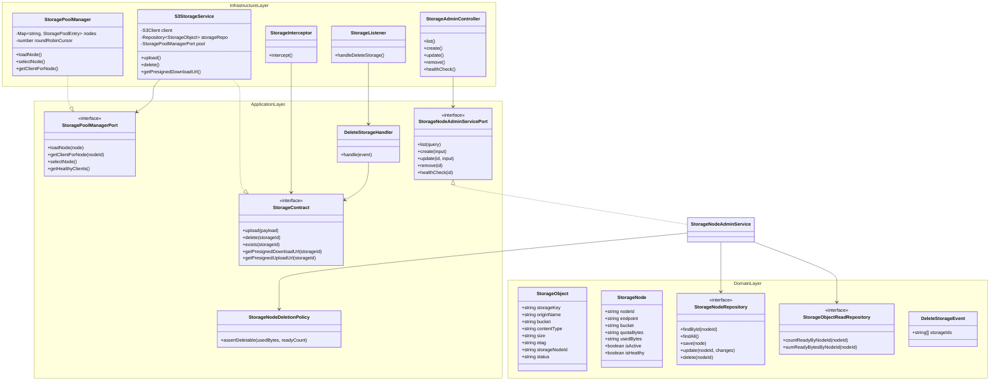
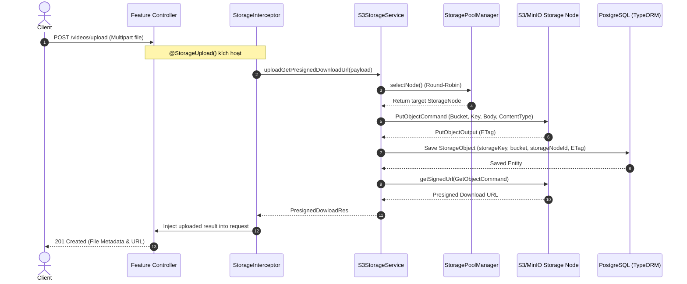
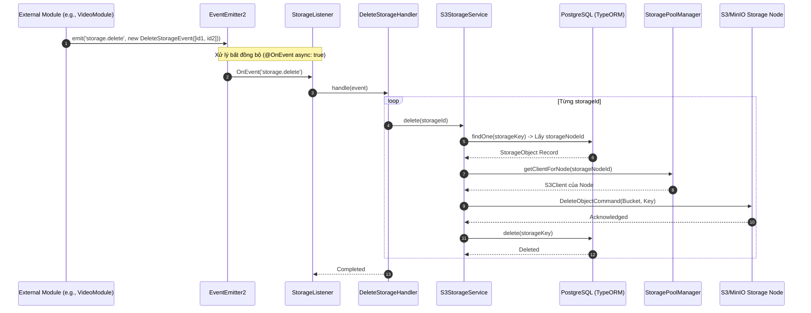
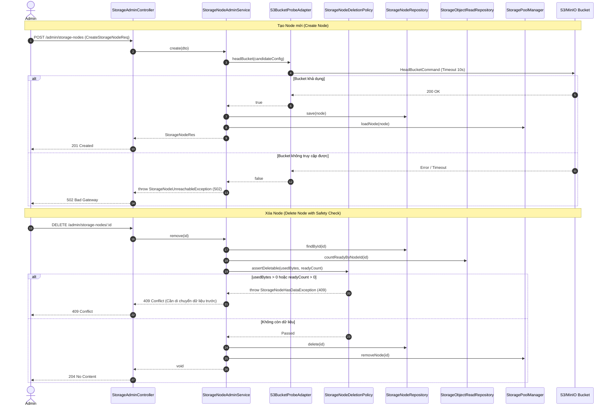

# Tài liệu Kiến trúc Storage Module — MyCast Backend

Tài liệu này mô tả chi tiết thiết kế kiến trúc, các thành phần phân lớp theo Domain-Driven Design (DDD) & Clean Architecture, luồng dữ liệu và cơ chế vận hành của **Storage Module** (`backend/src/modules/core/storage`) trong nền tảng MyCast.

---

## 1. Tổng quan & Vai trò nghiệp vụ (Overview & Purpose)

Storage Module đóng vai trò là **lớp trừu tượng hóa lưu trữ đối tượng (Object Storage Abstraction Layer)** cho toàn bộ hệ sinh thái MyCast. Hệ thống hỗ trợ đa nền tảng lưu trữ tương thích giao thức S3 (AWS S3, MinIO, Cloudflare R2, Ceph, v.v.) với các đặc tính cốt lõi:

- **Đa nút lưu trữ (Multi-Node Connection Pool)**: Cho phép kết nối và phân phối tải lưu trữ trên nhiều storage nodes/buckets khác nhau.
- **Điều phối tải Round-Robin**: Phân phối cân bằng tải upload giữa các nút lưu trữ đang hoạt động và khỏe mạnh (`isHealthy = true`, `isActive = true`).
- **Presigned URLs**: Sinh URL có thời hạn cho client tải lên trực tiếp (presigned upload) hoặc tải xuống (presigned download), giảm tải băng thông máy chủ backend.
- **Xóa an toàn & Bất đồng bộ dựa trên sự kiện (Event-driven Asynchronous Deletion)**: Lắng nghe `DeleteStorageEvent` qua `EventEmitter2` để dọn dẹp tệp vật lý và metadata ngầm không block luồng xử lý chính.
- **Chính sách bảo vệ nút (Node Deletion Policy)**: Ngăn chặn xóa nút lưu trữ nếu còn dữ liệu hoặc còn đối tượng đang ở trạng thái `READY`.
- **Interceptors & Decorators tiện dụng**: Cung cấp `@StorageUpload()` và `StorageInterceptor` để tự động upload tệp từ HTTP multipart/form-data vào storage và inject kết quả vào request.
- **Module Toàn cục (@Global)**: Xuất khẩu hợp đồng chuẩn (`STORAGE_CONTRACT` / `STORAGE_SERVICE`) và `MockStorageContract` cho các downstream module (Video, Podcast, User, Media) tiêu thụ độc lập và dễ dàng viết unit/integration tests.

---

## 2. Phân lớp kiến trúc Clean Architecture & DDD

Module được tổ chức nghiêm ngặt theo 4 phân tầng của Clean Architecture:

```
backend/src/modules/core/storage/
├── contracts/                        # Module Contracts & Public Interfaces
│   └── storage.contract.ts          # STORAGE_CONTRACT, DTOs & MockStorageContract
├── domain/                           # Enterprise Business Rules & Entities
│   ├── entities/                    # StorageObject, StorageNode
│   ├── enums/                       # StorageObjectStatus
│   ├── events/                      # DeleteStorageEvent
│   ├── exceptions/                  # StorageDomainException & subclasses
│   └── repositories/                # StorageNodeRepository, StorageObjectReadRepository
├── application/                      # Application Business Rules & Use Cases
│   ├── ports/                       # StorageService, StoragePoolManagerPort, StorageNodeAdminService, S3BucketProbe
│   ├── services/                    # StoragePoolManager, StorageNodeAdminService
│   ├── policies/                    # StorageNodeDeletionPolicy
│   ├── handlers/                    # DeleteStorageHandler
│   └── types/                       # StoragePoolEntry, StorageUploadOption
├── infrastructure/                   # Frameworks, Drivers & Adapters
│   ├── controllers/                 # StorageAdminController (/admin/storage-nodes)
│   ├── adapters/                    # S3BucketProbeAdapter (AWS SDK HeadBucket)
│   ├── repositories/                # StorageNodeTypeOrmRepository, StorageObjectTypeOrmReadRepository
│   ├── interceptors/                # StorageInterceptor, StorageExceptionInterceptor
│   ├── listeners/                   # StorageListener (@OnEvent)
│   ├── decorators/                  # StorageUpload (@StorageUpload)
│   └── s3-storage.service.ts        # AWS SDK S3 implementation of StorageContract
├── dtos/                             # Request/Response DTOs & Validators
│   ├── req.dto.ts
│   └── res.dto.ts
├── storage.constant.ts               # FILE_PATH, FILES_PATH constants
├── storage.module.ts                 # NestJS Module Definition (@Global)
└── index.ts                          # Public Barrel Export
```

### 2.1. Domain Layer (`domain/`)

Tầng trung tâm chứa thực thể nghiệp vụ cốt lõi, không phụ thuộc vào framework bên ngoài:

1. **Entities**:
   - `StorageObject`: Đại diện cho một đối tượng (file) được lưu trữ.
     - Khóa chính: `storageKey` (varchar 500) — đường dẫn/key duy nhất của đối tượng.
     - Thuộc tính: `originName`, `bucket`, `contentType`, `size`, `etag`, `storageNodeId`, `status`, `createdAt`.
     - Chỉ mục kép: `@Index('IDX_storages_node_status', ['storageNodeId', 'status'])` tối ưu truy vấn đếm và kiểm tra trạng thái file theo node.
   - `StorageNode`: Đại diện cho một nút máy chủ lưu trữ S3/MinIO.
     - Khóa chính: `nodeId` (varchar 36).
     - Cấu hình kết nối: `name`, `endpoint`, `region`, `bucket`, `forcePathStyle`, `accessKeyId`, `secretAccessKey`, `publicUrl`.
     - Quản lý hạn mức & trạng thái: `quotaBytes` (bigint), `usedBytes` (bigint), `isActive` (boolean), `isHealthy` (boolean), `createdAt`, `updatedAt`.
2. **Enums**:
   - `StorageObjectStatus`: `PENDING`, `READY`, `FAILED`, `DELETING`.
3. **Domain Events**:
   - `DeleteStorageEvent`: Kế thừa `DomainEvent`. Mang payload danh sách `storageIds: string[]` với tên sự kiện chuẩn `storage.delete`.
4. **Domain Exceptions**:
   - `StorageDomainException`: Base exception cho toàn bộ lỗi nghiệp vụ domain.
   - `StorageNodeHasDataException`: Bắn ra khi người dùng cố gắng xóa node còn chứa dữ liệu hoặc đối tượng READY.
   - `StorageNodeIdExistsException`: Node ID bị trùng lặp.
   - `StorageNodeNotFoundException`: Không tìm thấy node tương ứng.
   - `StorageNodeUnreachableException`: Thăm dò kết nối bucket (`HeadBucket`) thất bại.
   - `InvalidStorageInputException`: Dữ liệu cấu hình node không hợp lệ (ví dụ `quotaBytes` không phải safe integer không âm).
5. **Domain Repositories (Interfaces)**:
   - `StorageNodeRepository`: Định nghĩa hợp đồng CRUD cho thực thể `StorageNode`.
   - `StorageObjectReadRepository`: Đọc trạng thái dữ liệu của node (`countReadyByNodeId`, `sumReadyBytesByNodeId`).

---

### 2.2. Application Layer (`application/`)

Tầng điều phối nghiệp vụ, độc lập với cơ chế HTTP hoặc database cụ thể:

1. **Ports (Interfaces & Injection Tokens)**:
   - `STORAGE_SERVICE` (`StorageService` = `StorageContract`): Port cung cấp các tác vụ lưu trữ (upload, delete, exists, presigned URLs).
   - `STORAGE_POOL_MANAGER` (`StoragePoolManagerPort`): Quản lý vòng đời `S3Client` pool (loadNode, refreshNode, removeNode, getClientForNode, selectNode, getHealthyClients).
   - `STORAGE_NODE_ADMIN_SERVICE` (`StorageNodeAdminService`): Port quản lý CRUD và health check cho các nút lưu trữ.
   - `S3_BUCKET_PROBE` (`S3BucketProbe`): Port thăm dò kiểm tra tính kết nối tới S3 bucket.
2. **Services**:
   - `StoragePoolManager`:
     - Nạp toàn bộ active nodes từ database vào memory pool khi ứng dụng khởi chạy (`OnModuleInit`).
     - Quản lý `Map<string, StoragePoolEntry>` chứa các instance `S3Client`.
     - Phân bổ upload theo thuật toán **Round-Robin** thông qua con trỏ `roundRobinCursor`.
     - Hủy tài nguyên `client.destroy()` khi node bị xóa hoặc cập nhật cấu hình.
   - `StorageNodeAdminService`:
     - Quản lý thêm/sửa/xóa/liệt kê node.
     - Tự động chạy `S3BucketProbe` trước khi lưu vào DB khi tạo mới hoặc khi cập nhật thông tin kết nối.
     - Cập nhật pool tương ứng (`loadNode`, `refreshNode`, `removeNode`).
     - Tích hợp kiểm tra an toàn xóa qua `StorageNodeDeletionPolicy`.
3. **Policies**:
   - `StorageNodeDeletionPolicy`: Thực thi quy tắc bảo toàn dữ liệu: ném `StorageNodeHasDataException` nếu `usedBytes > 0` hoặc `readyObjectCount > 0`.
4. **Handlers**:
   - `DeleteStorageHandler`: Triển khai interface `Handler<DeleteStorageEvent>`. Duyệt danh sách ID và gọi `storageService.delete(storageId)` song song với error handling riêng lẻ từng tệp.

---

### 2.3. Infrastructure Layer (`infrastructure/`)

Tầng cài đặt chi tiết kỹ thuật, liên kết với thư viện AWS SDK, TypeORM, NestJS:

1. **`S3StorageService`**:
   - Triển khai `StorageContract` và `StorageService`.
   - Sử dụng `@aws-sdk/client-s3` (`PutObjectCommand`, `DeleteObjectCommand`, `HeadObjectCommand`, `GetObjectCommand`) và `@aws-sdk/s3-request-presigner` (`getSignedUrl`).
   - Tự động phân giải node:
     - Khi `upload`: Gọi `pool.selectNode()` để lấy node khả dụng theo Round-Robin, lưu record `StorageObject` với `storageNodeId = node.nodeId`.
     - Khi `delete` / `exists` / `getPresignedDownloadUrl`: Tra cứu `storageKey` trong DB để lấy `storageNodeId`, sau đó gọi `pool.getClientForNode(storageNodeId)`.
2. **Adapters & Repositories**:
   - `S3BucketProbeAdapter`: Triển khai `S3BucketProbe`, tạo một `S3Client` tạm thời để gửi lệnh `HeadBucketCommand` với timeout 10 giây qua `AbortSignal.timeout(10_000)`.
   - `StorageNodeTypeOrmRepository`: Cài đặt TypeORM cho `StorageNodeRepository`.
   - `StorageObjectTypeOrmReadRepository`: Cài đặt TypeORM đọc số lượng đối tượng và tính tổng dung lượng (`SUM(CAST(size AS BIGINT))`).
3. **Interceptors & Decorators**:
   - `StorageInterceptor`: Tự động trích xuất file từ request (`Express.Multer.File`), upload lên storage thông qua `uploadGetPresignedDowloadUrl`, và gán DTO phản hồi trở lại vào request body/property.
   - `StorageExceptionInterceptor`: Bắt các `StorageDomainException` và map thành mã HTTP tương ứng:
     - `StorageNodeNotFoundException` -> `404 Not Found`
     - `StorageNodeIdExistsException` / `StorageNodeHasDataException` -> `409 Conflict`
     - `StorageNodeUnreachableException` -> `502 Bad Gateway`
     - `InvalidStorageInputException` -> `400 Bad Request`
   - `@StorageUpload(options)`: Đính kèm metadata đường dẫn upload vào controller route handler.
4. **Listeners**:
   - `StorageListener`: Bắt sự kiện bất đồng bộ `@OnEvent('storage.delete', { async: true })`, deserialize payload nếu cần và chuyển tiếp cho `DeleteStorageHandler`.
5. **Controllers**:
   - `StorageAdminController`: Cung cấp REST API tại `/admin/storage-nodes`:
     - `GET /admin/storage-nodes`: Danh sách nodes (hỗ trợ lọc `?status=healthy|unhealthy`).
     - `POST /admin/storage-nodes`: Đăng ký node mới.
     - `PATCH /admin/storage-nodes/:id`: Cập nhật cấu hình node.
     - `DELETE /admin/storage-nodes/:id`: Xóa node (HTTP 204).
     - `POST /admin/storage-nodes/:id/health-check`: Kiểm tra tức thời sức khỏe node.
     - Bảo mật: Yêu cầu `JwtGuard`, `RoleGuard` với vai trò `Role.ADMIN`.

---

### 2.4. Contracts Layer (`contracts/`)

Cung cấp giao diện công khai để giao tiếp liên module theo quy chuẩn kiến trúc của MyCast:

- **Token**: `STORAGE_CONTRACT` (Symbol).
- **Interface**: `StorageContract` gồm các hàm:
  - `upload(payload: StorageUploadPayload): Promise<StorageUploadResult>`
  - `delete(storageId: string): Promise<void>`
  - `exists(storageId: string): Promise<boolean>`
  - `getPresignedDownloadUrl(storageId: string, expiresIn?: number): Promise<StoragePresignedDownloadResult>`
  - `uploadGetPresignedDownloadUrl(payload: StorageUploadPayload, expiresIn?: number): Promise<StoragePresignedDownloadResult>`
  - `getPresignedUploadUrl(storageId: string, options?: StoragePresignedUrlOptions): Promise<StoragePresignedUploadResult>`
  - `getUrlByStorageId(storageId: string): Promise<StoragePresignedDownloadResult>`
- **Mock Contract**: `MockStorageContract` — Mock in-memory hoàn chỉnh dùng cho unit test của các module phụ thuộc mà không cần thiết lập hạ tầng S3 thật.

---

## 3. Sơ đồ kiến trúc & Luồng dữ liệu (Architecture Diagrams)

### 3.1. Sơ đồ phân lớp Clean Architecture



---

### 3.2. Luồng tải tệp lên (Upload Data Flow)



---

### 3.3. Luồng xóa đối tượng bất đồng bộ (Event-driven Deletion Flow)



---

### 3.4. Luồng kiểm tra và quản trị Node (Admin & Health Check Flow)



---

## 4. Đặc tả API Quản trị Storage Nodes

Tất cả các endpoint dưới đây yêu cầu xác thực Bearer JWT của người dùng có quyền `ADMIN`.

| Method | Endpoint | Mô tả | Mã phản hồi |
|---|---|---|---|
| `GET` | `/admin/storage-nodes` | Lấy danh sách nodes. Hỗ trợ query: `?status=healthy` hoặc `?status=unhealthy` | `200 OK` |
| `POST` | `/admin/storage-nodes` | Thêm nút lưu trữ mới. Tự động probe bucket trước khi lưu | `201 Created`, `400`, `409`, `502` |
| `PATCH` | `/admin/storage-nodes/:id` | Cập nhật cấu hình node (quota, credentials, isActive). Tự động probe nếu đổi thông số kết nối | `200 OK`, `400`, `404`, `502` |
| `DELETE` | `/admin/storage-nodes/:id` | Xóa node. Chặn xóa nếu còn dữ liệu hoặc object READY | `204 No Content`, `404`, `409` |
| `POST` | `/admin/storage-nodes/:id/health-check` | Kiểm tra tức thời kết nối thực tế tới bucket của node và cập nhật trạng thái `isHealthy` | `200 OK`, `404` |

---

## 5. Hướng dẫn tích hợp cho các Module khác (Integration Guide)

### 5.1. Import Module
`StorageModule` được khai báo `@Global()`. Trong các feature module hoặc `CoreModule`:
```typescript
import { Module } from '@nestjs/common';
import { StorageModule } from '../core/storage/storage.module';

@Module({
  imports: [StorageModule],
})
export class MediaModule {}
```

### 5.2. Sử dụng StorageContract trực tiếp trong Service
```typescript
import { Inject, Injectable } from '@nestjs/common';
import { STORAGE_CONTRACT, StorageContract } from '../core/storage/contracts/storage.contract';

@Injectable()
export class VideoMediaService {
  constructor(
    @Inject(STORAGE_CONTRACT)
    private readonly storage: StorageContract,
  ) {}

  async generateThumbnailUrl(thumbnailKey: string): Promise<string> {
    const res = await this.storage.getPresignedDownloadUrl(thumbnailKey, 7200);
    return res.url;
  }
}
```

### 5.3. Sử dụng StorageInterceptor cho Upload Controller
```typescript
import { Controller, Post, UseInterceptors, UploadedFile } from '@nestjs/common';
import { FileInterceptor } from '@nestjs/platform-express';
import { StorageInterceptor } from '../core/storage/infrastructure/interceptors/storage.interceptor';
import { StorageUpload } from '../core/storage/infrastructure/decorators/storage-upload.decorator';
import { PresignedDowloadRes } from '../core/storage/dtos/res.dto';

@Controller('videos')
export class VideoUploadController {
  @Post('avatar')
  @UseInterceptors(FileInterceptor('file'), StorageInterceptor)
  @StorageUpload([{ field: 'file', path: 'avatars' }])
  uploadAvatar(@UploadedFile() file: PresignedDowloadRes) {
    return {
      storageId: file.storageId,
      url: file.url,
    };
  }
}
```

### 5.4. Kích hoạt xóa tệp qua Domain Event
```typescript
import { Injectable } from '@nestjs/common';
import { EventEmitter2 } from '@nestjs/event-emitter';
import { DeleteStorageEvent } from '../core/storage/domain/events/delete-storage.event';

@Injectable()
export class VideoLifecycleService {
  constructor(private readonly eventEmitter: EventEmitter2) {}

  async removeVideoAssets(assetKeys: string[]): Promise<void> {
    // Phát sự kiện xóa không gây nghẽn luồng xử lý
    this.eventEmitter.emit(
      DeleteStorageEvent.EVENT_NAME,
      new DeleteStorageEvent(assetKeys),
    );
  }
}
```

### 5.5. Viết Unit/Integration Test với MockStorageContract
```typescript
import { Test, TestingModule } from '@nestjs/testing';
import { STORAGE_CONTRACT, MockStorageContract } from '../core/storage/contracts/storage.contract';

const moduleRef: TestingModule = await Test.createTestingModule({
  providers: [
    MyFeatureService,
    {
      provide: STORAGE_CONTRACT,
      useValue: MockStorageContract,
    },
  ],
}).compile();
```

---

## 6. Tổng kết đánh giá kiến trúc

- **Tuân thủ Clean Architecture & DDD**: Phân tách rõ ràng giữa Domain (nghiệp vụ lưu trữ, thực thể, quy tắc xóa), Application (điều phối pool, quản trị node, handler sự kiện), Infrastructure (AWS SDK v3, TypeORM, Controllers, Interceptors) và Contracts (cung cấp API dùng chung và Mock spec).
- **Mở rộng linh hoạt (High Scalability)**: Hỗ trợ ngang (horizontal scale) các storage nodes, cho phép cắm thêm các bucket/node S3/MinIO mới lúc runtime mà không cần restart server thông qua pool manager.
- **Tính khả dụng & Độ bền vững (Resilience)**: Cơ chế probe tự động kiểm tra bucket tính sống còn, thuật toán Round-Robin tự động bỏ qua các node không healthy, và sự kiện dọn dẹp chạy bất đồng bộ đảm bảo trải nghiệm người dùng luôn mượt mà.
